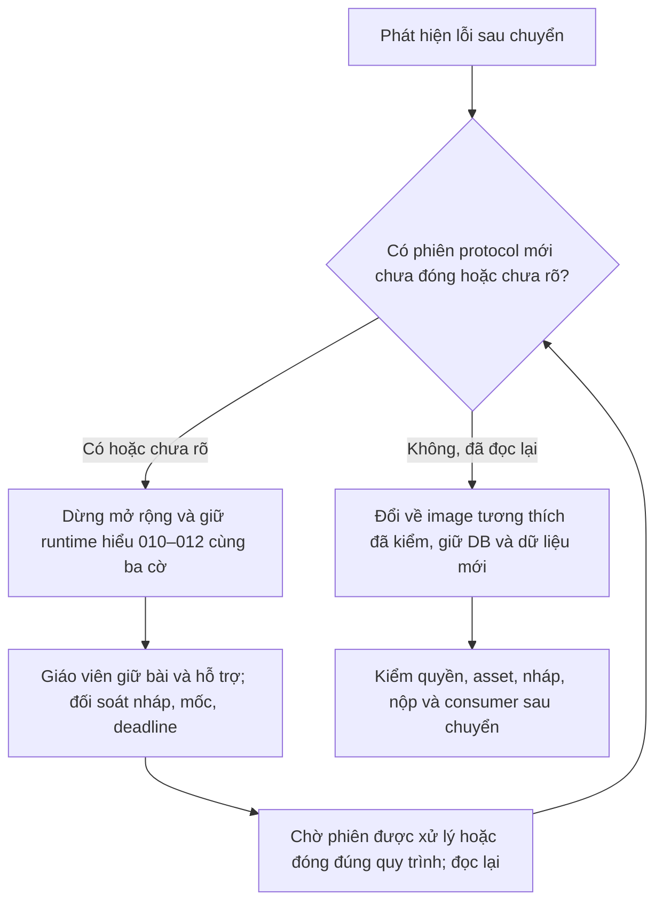

# K67 — phương án phát hành và quay lui bảo vệ audio

Chuẩn bị ngày 15/10/2026. **Chưa được phát hành.** Không dùng tài liệu này thay quyền merge/push/production riêng. Có lỗi tải ở đợt 60 người chung IP và 120 người bắt đầu đồng thời. Lỗi start đã commit nhưng chưa bảo vệ thời gian khi mất phản hồi phải được sửa trước phát hành, kể cả nhóm nhỏ; quota và công suất phải được kiểm lại ở phạm vi thực tế sẽ mở. Bộ thiết bị thật còn Chưa chạy.

## Phạm vi và ràng buộc

Chỉ K67 Term 1/2 và Mini CBT, cả hai thứ tự; giao diện vẫn một dòng tiêu đề. Không đổi K56, Speaking, Progress Log, writer, rubric hoặc Portal. Không dựng lại backend chung. Substitute/answer sheet không tự được tính là đã bật/đạt bảo vệ audio.

Ba cờ hiện là **toàn runtime**, không có allowlist theo lớp: `K67_AUDIO_INCIDENT_ENABLED`, `K67_AUDIO_CACHE_ENABLED`, `K67_AUDIO_OWNER_ENABLED`. Bật cờ không có nghĩa chỉ một lớp được cấp protocol mới. Pilot một lớp đòi hỏi khung giờ đã xác nhận không có nhóm khác mở CBT; nếu cần thi đồng thời nhiều lớp nhưng chỉ bật một lớp thì phải thêm cơ chế chọn lớp/phiên và kiểm riêng trước. Không giả có cổng canary chưa tồn tại.

## Trước khi chuyển

1. Tích hợp đúng commit ứng viên vào nền hiện hành trong quyền Git riêng. Rà diff dùng chung và đủ coverage theo byte nguồn/runner/fixture cuối; không tự chuyển nhãn pass của lát 3 sang bản đã tích hợp có khác logic.
2. Đọc lại chỉ metadata live: image/digest, build, env variable names và cờ, DB/role, trạng thái context, asset manifest/hash, hai đường API K67 hiện hành. Giữ bí mật mã hóa phiên tương thích; không in giá trị khóa hoặc thay khóa giữa phiên.
3. Lấy backup riêng nhất quán; diễn tập restore ở đích trống có đúng marker và readback. Không chạy lại helper restore/chuyển 13 bảng cũ vào kho đang có bài. Lát 4 đã diễn tập cơ chế trên PostgreSQL local, chưa chứng minh backup production mới nhất khôi phục được.
4. Đối chiếu migration hiện hành; chỉ áp delta còn thiếu, theo thứ tự 009–012, không chạy lại mù. Giữ 010 giữ bài, 011 pin/cache và 012 chủ phát tương thích. Nếu lock timeout thì dừng thao tác, giữ nguồn/cấu hình, không ép khóa hoặc xóa trigger.
5. Dựng ứng viên K67 riêng với quota thật, DB/role K67, cùng bí mật phiên/asset, cờ tắt; không đụng runtime chung. Kiểm /ready, /version, quyền, CORS/CSP, content/crypto và hành trình giả ở đích được phép.
6. Có người phụ trách thiết bị và giáo viên hỗ trợ; hoàn thành [bảng nghiệm thu](AUDIO_DEVICE_ACCEPTANCE.md). Chốt số người/lớp thi đồng thời và số người chung IP từ thực tế; các mức 25/60/120 local chỉ là mức thăm dò.

Truy vấn dưới chỉ đếm trạng thái, không trả bài/tên/token. Người vận hành chạy read-only trên DB K67 đã xác minh, ngay trước chuyển và trước quay lui. Nếu query không chạy do schema khác thì kết quả là Chưa rõ, không coi là 0.

```sql
-- Đếm mọi phiên protocol mới chưa đóng, gồm phiên đã nhận chủ nhưng chưa bắt đầu.
SELECT
  count(*) FILTER (WHERE listening_started_at IS NULL) AS prepared,
  count(*) FILTER (WHERE listening_started_at IS NOT NULL) AS started,
  count(*) FILTER (WHERE listening_audio_incident_id IS NOT NULL) AS holding
FROM assessment.term_test_exam_session
WHERE superseded_at IS NULL AND listening_submitted_at IS NULL
  AND (audio_owner_protocol=1 OR listening_audio_protocol_version=1);
```

## Phát hành sau khi được phép

1. Đưa migration/backend tương thích lên trước. Xác nhận không nâng protocol của phiên đã bắt đầu; kiểm một phiên cũ tiếp tục lưu/nộp và phiên mới mở đúng luồng.
2. Phát hành frontend có revision module/CSS đúng, kiểm trực tiếp URL dưới prefix Pages bằng Chrome/Edge, gồm tab mở từ phiên bản cũ và reload. Đọc lại các tài nguyên đã phát hành; một dòng tiêu đề không tạo hàng mới ở 1440/390 px.
3. Trong khung pilot đã kiểm số lớp/người, bật ba cờ cho phiên mới. Các phiên khác vẫn là trách nhiệm vận hành vì hiện chưa có bộ lọc lớp. Không đổi cờ giữa một buổi đang có phiên mới chưa đóng.
4. Theo dõi từ bắt đầu đến nộp: HTTP429/5xx theo route, p95 mở bài/giữ bài, chờ pool, RSS, context freshness, incident đang mở, tiến độ ACK trễ, giây bù và nộp bị chặn. Nhiều HTTP lỗi nhưng audio vẫn tiến không được tự pause vì telemetry.
5. Kiểm người dùng thấy/ nghe được, đọc lại nháp/deadline/incident/submitted; Portal/chấm là outcome khác. Chỉ mở rộng sau khi pilot đủ thời lượng, mọi sự cố được giải thích và các ca quan trọng không còn Chưa rõ.

Mức chờ tham chiếu: controller hiện timeout một request incident/tiến độ khoảng 2,5 giây; pool chờ kết nối 5 giây và statement timeout 15 giây. Các ngưỡng cảnh báo ban đầu: p95 control gần 2 giây, bất kỳ start 5xx/nháp sai/thu bài sai/bù lặp hoặc nhận quyền phát chồng phải dừng mở rộng. Đây là tiêu chí pilot, chưa là SLA production.

## Quay lui theo trạng thái phiên



Không dùng **tắt cả ba cờ** như cách khôi phục đầy đủ giữa phiên: diễn tập local cho thấy cờ cache tắt làm `audio-access` trả `audioCacheSupported=false`, dù guard chủ cũ vẫn còn. Không hạ về image trước 012 khi còn phiên dùng owner/hold; không trả về dump cũ, xóa journal/incident, giảm deadline hoặc đổi secret/audio file đã ghim.

“Dừng mở rộng” là dừng đợt vận hành/không tổ chức thêm lượt; ứng dụng hiện **chưa có chế độ drain chỉ chặn phiên mới mà vẫn cho mọi reload**. Không chặn mù `/session/prepare` ở Nginx vì reload cũng dùng đường này. Nếu cần cưỡng chế drain kỹ thuật, đó là thay đổi cần xây/kiểm trước một đợt phát hành sau.

Fallback tốt nhất là image **còn hiểu protocol mới** và đã thử với cùng DB/secret/manifest; đây khác việc quay về image cũ bất kỳ. Nếu lỗi nghiêm trọng khiến không giữ được invariant, giáo viên dừng thi và bảo toàn bài; chưa có nút override/tua từ xa, không sửa DB trực tiếp để ép tiếp tục.

## Bằng chứng đã có và còn thiếu

Đã diễn tập local `pg_dump`/`pg_restore` thật, giữ hash nháp/deadline/incident/manifest/owner, guard PostgreSQL sau restore, thay runtime tương thích giữ khóa phiên, phục hồi và xác nhận lặp không bù hai lần, rồi nộp đọc lại. Kết quả là cơ chế local; chưa đổi tuyến Nginx/image/quota thật hoặc quan sát một buổi thi production.

Lệnh thử an toàn và số đo tải ở `AUDIO_LOAD_SLICE4.md`. Helper `rehearse-production-release.py` thuộc đợt chuyển cũ, không được chạy tự động từ lát 4 hoặc suy lần đổi cùng image trước đây thành chứng minh rollback qua protocol 012.
